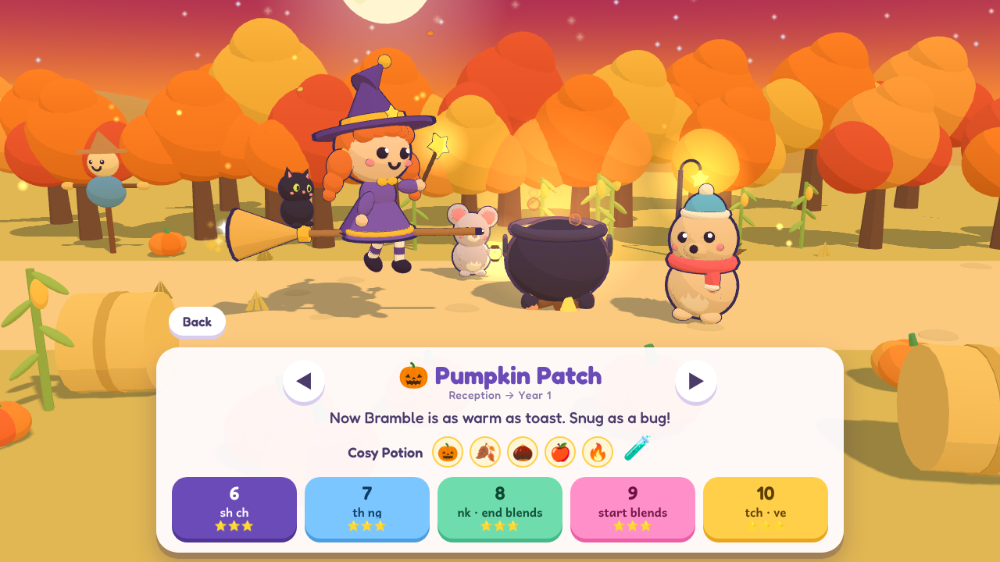

# Spelling games

Two gentle, no-stress spelling games for young children. Both are built in 3D with
[three.js](https://threejs.org/), run in any modern browser, and save progress on the device.

| | Game | Open |
|---|---|---|
| **v2** | **Little Star Witch** — a story-led spelling adventure for 5–7 year olds who love witches | [`v2/index.html`](v2/index.html) |
| v1 | Gem Fairy — type words to catch gems | [`index.html`](index.html) |

---

## v2 · Little Star Witch 🧙‍♀️⭐

> One night a baby dragon with a tickly nose did a great big sneeze — *ACHOO!* — and blew all the
> stars out of the sky. They are hiding in the Whispering Wood. A little witch and her cat fly
> out on their broom to **spell them home**.



Every level has two parts:

1. **Fly** — a lost star peeks out of a pumpkin, a mushroom or a snowdrift, holding a word.
   Read it and type it; the star whooshes back up into the sky. Each right letter rings one note
   higher than the last. A star that isn't spelled in time just hides and comes back later.
   The word is shown on its own, with no picture to guess from — its picture pops out as the
   reward once it has been spelled.
2. **Brew** — land beside the cauldron. *Look* at a word, it is *covered*, then *build it* from
   sound tiles (`sh` `i` `p`) and *check*. Three words make one potion ingredient — and the last
   of the three is a **⭐ star challenge**: the word is never shown. The child hears it, sees its
   picture, and writes it letter by letter on a whole keyboard.

Five ingredients make a potion for a woodland friend who needs a little help: Pip the mouse is
scared of the dark, Bramble the hedgehog is cold, Lily the frog has lost her croak, Flit the bat is
shy, Hoot the owl has a sore wing — and in the last place, Ember the baby dragon needs a Get Well
Potion for that sneezy cold. Everyone you help comes along on the rest of the adventure.

Now and then a **woodland visitor** was hiding with the star — Clover the bunny, Rusty the fox cub,
Waddle the penguin… — and hops along for the rest of the level. Eighteen of them live in the wood,
three in each place (one of each three is shy). The map shows who has been found and how many are
still hiding, and a couple of the ones already found turn up at the start of every level.

### What's in it

- **30 levels in 6 places** (Cottage Garden, Pumpkin Patch, Misty Pond, Mushroom Glade, Frosty
  Peak, Moon Castle), each with its own sky, scenery and friend. About 650 words.
- **No two levels alike**: each of a place's five levels is flown at a different time of day
  (evening, golden hour, twilight, starry night, dawn) and its scenery is laid out afresh.
- **18 woodland visitors to find**, who pop out in the middle of a level and come along.
- **Sound buttons** under every word — a dot for one letter, a bar for a digraph (`sh`, `igh`),
  an arc for a split digraph (`a-e`) — the same marking children see in phonics lessons.
- **Read aloud — or not**: the story, each word when a star goes home, and the word to spell when
  brewing can be read out. The 🗣️ button (title screen, pause card and top corner while playing)
  turns the voice off so the child does all the reading. Tap any word to hear it.
- **Your own voice**: the computer voice is only a stand-in. Record the words and story lines
  yourself and the game uses your recordings instead — see [Recording your own voice](#recording-your-own-voice).
- **Kind by design**: nothing can be lost or failed. The wood slows down while a word is being
  typed, the next key glows if a child is stuck, and after two wrong tries the right tile lights up.
  In a star challenge the word is said again after two slips and the next letter lights up after three.
- **Words that wobble come back**: a word that hid or needed several tries is remembered and
  slipped into later levels for another go. Brewing favours the words that were hardest when flying.
- **Dress up**: choose skin, hair, outfit, cat and broom sparkles, and name the witch.
  New outfits and cats unlock as stars are collected.
- **On-screen keyboard** for touch screens, in lower case, with vowels picked out; `q w e r t y` or
  `a b c` order. It tucks itself away as soon as a real keyboard is typed on, and comes back at
  a touch. `Esc` pauses, `Backspace` lets go of a word.
- **Key practice** (⌨️ Keys on the title page): ten one-letter stars, chosen by spaced repetition.
  At most three keys are worked on at once; known keys come back less and less often. When a
  letter can't be found, a little picture of the keyboard shows where it is.
- **Letter fireflies**: a short warm-up of single letters on fireflies opens a level, for its keys
  that are not yet known; they never count as stars. Unfamiliar keys are pointed out at once.
- **Words to find in every level**: the map shows the words found in each level and a crown when
  all are found, so there is a reason to play a level again.
- **No level with too many hard keys**: a level's phonics decide which words it can use, and the
  keys decide which of them are used today, so its words lean on only a few keys that are not
  yet known.
- **A page for grown-ups**: settings, the curriculum focus of every level, the child's wobbly
  words, which keys are slow to find or often mixed up, and a switch to unlock every level so
  an older child can start further on.
- **Works offline**: three.js and the fonts are bundled, sound effects are made in code, and after
  one visit over https the game is cached and can be added to a tablet's home screen.

### Curriculum link (England)

The hardest thing about the game for a five-year-old is finding the keys, so the letters come
first and the phonics second. Levels 1–10 bring in two to four new keys at a time (in the order
phonics teaches the letters) and use only words where every letter is its own sound. From level 11
the spellings where letters work together follow, loosely in the order they are taught in English
primary schools — Reception phonics, then the spelling content of the National Curriculum for
Year 1 and Year 2 (English Appendix 1). It is a practice game, not a scheme of work.

| Place | Levels | Roughly | Focus |
|---|---|---|---|
| 🏡 Cottage Garden | 1–5 | Finding the keys (Phase 2 letters) | new keys `s a t p`, `i n`, `m d`, `g o`, `c k` — two-, three- and four-letter words, one star at a time |
| 🎃 Pumpkin Patch | 6–10 | Finding the keys (Phases 2–4) | new keys `e u`, `r h`, `b f l`, `j v w`, `x y z q` — the whole alphabet, still one letter per sound |
| 🐸 Misty Pond | 11–15 | Reception → Year 1 (Phase 3) | two letters, one sound: `ck ff ll ss zz`, `sh ch`, `th ng`, `tch` and `-ve`, `ai ee` |
| 🍄 Mushroom Glade | 16–20 | Year 1 (Phases 3 and 5) | `igh oa oo`, `ar or ur`, `ow oi ear air er`, split digraphs `a-e i-e o-e u-e e-e` |
| ❄️ Frosty Peak | 21–25 | Year 1 | `ay ou ie ea`, `oy ir ue aw`, `wh ph ew`, Year 1 common exception words |
| 🏰 Moon Castle | 26–30 | Year 1 → Year 2 | `-s -es -ing -ed -er -est`, `un-`, `-y`, compound words, `ore are ear au`, `kn gn wr`, `dge ge` and soft `c`, `-le -el -al -il`, `all`, `wa`, `wor`, `o` as in *other*, `-ey`, Year 2 common exception words |

Typing a word that is on screen practises reading, letter recognition and keyboard skills.
Brewing practises spelling from memory with the "look, cover, write, check" routine, and building
words from graphemes rather than single letters. The star challenge is a one-word dictation:
segmenting a spoken word into its sounds and writing them down unaided. The grown-ups page can
switch brewing to always look first, or to challenges only. In the keyboard levels (1–10) brewing
keeps to words of four letters or fewer, and the star challenge only ever asks for a two- or
three-letter word.

### Running it

Open `v2/index.html` in a browser — it works straight from disk, no internet needed.
To also get the offline cache and "add to home screen", serve the folder:

```bash
python3 -m http.server 8000      # then visit http://localhost:8000/v2/
```

### How it is put together

No build step and no dependencies to install. Plain scripts, loaded in order:

| File | What it holds |
|---|---|
| `v2/js/words.js` | the six places, thirty levels and all the words (with their sound buttons) |
| `v2/js/core.js` | saved progress, sound effects (Web Audio), music |
| `v2/js/voice.js` | reading aloud: recorded clips first, the computer voice as a stand-in, and the list of every line the game can say |
| `v2/js/textures.js` | procedural surface textures painted on canvases (fur, wood, stone, fabric, leaves, water ripples, the moon) |
| `v2/js/engine.js` | renderer, lights, post-processing, materials, shape helpers, mesh merging, particles, camera |
| `v2/js/models.js` | the witch, her cat, the six friends, cauldron, stars, wardrobe colours |
| `v2/js/world.js` | sky, moon, terrain, water, the six biomes with their scenery, ground cover and hiding spots |
| `v2/js/game.js` | the flying part: words, typing, stars, level flow |
| `v2/js/brew.js` | the brewing part and the "friend gets a potion" scenes |
| `v2/js/ui.js` | title, map, dress up, friends, story, grown-ups page |
| `v2/js/main.js` | keyboard input, the frame loop, start-up |
| `v2/record.html`, `v2/js/record.js` | the Voice studio, a page for recording your own voice-over |
| `v2/voice/` | recorded clips, the generated list of them, and the recording checklist |

To add or change words, edit `v2/js/words.js` — the notation is explained at the top of the file
(`"sh.i.p:🚢"` is *ship*, split into its three sounds, with a picture clue).

Progress is stored in the browser's `localStorage` under `littleStarWitch.v2`.

### How it is drawn

Everything on screen is made in code — there are no model or image files.

- **Light**: a warm key light with soft shadows, a cool sky/ground fill and a coloured rim light,
  plus image-based lighting from a tiny sky scene baked for each place. Filmic (ACES) tone mapping,
  a gentle bloom on the things that glow (stars, wand, lamps, windows), a touch of colour grading
  and a vignette.
- **Surfaces**: every material is physically based and carries a procedural detail texture —
  knitted fur, wood grain, woven cloth, pitted stone, leaf clumps — that varies its colour and
  roughness and gives it bumps. The textures are projected in world space, so nothing needs UVs.
- **Shapes**: bodies, hats, pots and trunks are lathed or extruded with rounded edges; tree
  canopies, rocks, snow and clouds are pushed around with simplex noise so no two look alike.
- **Movement**: leaves and grass sway in the vertex shader, the pond has two layers of drifting
  ripples, the potion swirls, and fireflies, pollen, snow or falling leaves drift on the GPU.
- **Ground cover**: thousands of grass tufts, pebbles, flowers and fallen leaves are instanced,
  each with its own size, turn and tint.

There are three quality levels (grown-ups page → Graphics, or `?quality=fast|medium|best` in the
address). On *auto* the game starts at the best level and steps down by itself if the device
cannot keep up.

### Recording your own voice

The game looks for a recording of each word or sentence before it falls back to the computer
voice, and "Only my recordings" on the grown-ups page silences the computer voice altogether.

- **The easy way** — grown-ups page → *Record your own voice* opens the **Voice studio**
  (`v2/record.html`). It shows each word and sentence in turn; press Space to record, Space to
  stop, Enter for the next one. Silence at the ends is trimmed, every take is saved as you go,
  and the game on that device uses it straight away. The words are listed place by place, so
  recording just the Cottage Garden words is enough for the first five levels.
- **To share recordings with every device**, download them from the studio as a `.zip` and unzip
  it into `v2/voice/` (or load the zip in the studio on another device).
- **With your own tools** — `v2/voice/README.md` explains the file names, and
  `v2/voice/RECORDING-LIST.md` lists everything the game can say. Run
  `node v2/voice/build-manifest.js` after adding files.

The microphone only works on `https://` or `localhost`, so the studio cannot record when the game
is opened straight from disk.

---

## v1 · Gem Fairy

A little puppy fairy flies through a sunny woodland. Gems peek out of bushes, mushrooms,
stumps and flowers, and each gem carries a word. **Type the word to catch the gem** —
the fairy zaps it with a star wand and it flies into the bag. If the fairy flies past before
the word is spelled, the gem just hides again. There's no losing, only trying again.

- **20 levels** that follow a phonics order: SATPIN words first, then new sounds,
  digraphs (sh, ch, th), blends, vowel teams, magic-e, tricky words, and finally long words.
- As levels go up the fairy flies faster and more gems can be out at once.
- The forest slows down while you're in the middle of spelling a word.
- **Colour challenges** on some levels: e.g. fill the bag of 10, with at least 4 green.
- Each gem caught has a chance to bring a **woodland friend** (bunny, bear, panda, frog,
  duckling, owl, fox, hedgehog) who joins the crew hopping along behind the fairy.
  See them all under **My Crew**.
- Stars per level: 3 stars for catching every gem, fewer if some hid again.
- Optional read-aloud: the game says each word when you catch it (🗣️ button).
- Touch screens get an on-screen keyboard, hidden while a real one is in use. `Esc` pauses, `Backspace` lets go of a word.

Progress, stars and your crew are saved in the browser (localStorage).

Open `index.html` in a browser (an internet connection is needed to load three.js and
the font). For sound to load reliably, serve the folder locally as above and visit
<http://localhost:8000>.

## Assets

All the 3D art in both games is made in code. Music, fonts and libraries are open-source —
see [CREDITS.md](CREDITS.md) for sources and authors.
